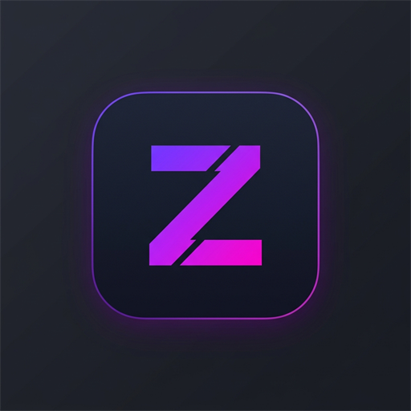

<div align="center">



# Zeus IDE

**Editor de código desktop, leve e open source, com Monaco Editor e terminal nativo integrado.**

[](https://github.com/CodigoRoxo/ZeusIDE/releases/latest)
[](https://github.com/CodigoRoxo/ZeusIDE/actions/workflows/ci.yml)
[](LICENSE)
[](https://www.youtube.com/@codigoroxo)

[**⬇ Baixar para Windows**](https://github.com/CodigoRoxo/ZeusIDE/releases/latest) · [Reportar bug](https://github.com/CodigoRoxo/ZeusIDE/issues/new?template=bug.yml) · [Sugerir recurso](https://github.com/CodigoRoxo/ZeusIDE/issues/new?template=feature.yml)

</div>

<!-- Adicione aqui um GIF ou screenshot da IDE em uso, por exemplo:
<p align="center"></p>
-->

## Download

Na página de [Releases](https://github.com/CodigoRoxo/ZeusIDE/releases/latest) há duas opções:

| Arquivo | Para quem |
| :--- | :--- |
| `ZeusIDE-Setup-x.y.z.exe` | Instalador com atalhos no menu Iniciar. **Recebe atualizações automáticas.** |
| `ZeusIDE-Portable-x.y.z.exe` | Executável único, sem instalação (bom para pendrive). Atualização manual. |

> **Aviso do Windows SmartScreen:** o executável ainda não é assinado digitalmente, então o Windows pode mostrar "O Windows protegeu o computador". Clique em **Mais informações → Executar assim mesmo**. O código-fonte completo está neste repositório, e você pode compilar o seu próprio executável (veja abaixo).

## Recursos

- **Explorador de arquivos**
  - Abre pastas pelo diálogo nativo do Windows, e a barra lateral tem largura ajustável.
  - Ao abrir a IDE, a sessão é restaurada: última pasta, pastas expandidas e abas abertas.
  - Atualiza sozinho quando arquivos mudam fora da IDE (git, npm, outros editores).
  - Cria, renomeia e exclui itens direto na árvore. Itens excluídos vão para a **Lixeira**.
- **Editor (Monaco, o mesmo do VS Code)**
  - Destaque de sintaxe para dezenas de linguagens, 100% offline.
  - Temas escuro e claro próprios, minimapa, dobra de código e colorização de colchetes.
  - Proteção contra abrir binários ou arquivos muito grandes (acima de 5 MB) por engano.
- **Paleta de comandos**
  - `Ctrl+P` busca qualquer arquivo do projeto por nome (busca fuzzy).
  - `Ctrl+Shift+P` (ou `>` na busca) lista os comandos da IDE.
- **Abas**
  - Indicador de alterações pendentes.
  - Ao fechar uma aba ou a janela com algo não salvo, a IDE pergunta antes ("Salvar tudo e fechar").
- **Terminal integrado (node-pty / ConPTY)**
  - Prompt de Comando ou PowerShell, já na pasta do projeto.
  - Painel retrátil e redimensionável.
- **Atualizações automáticas** (versão instalada), via GitHub Releases.

## Atalhos de teclado

| Atalho | Ação |
| :--- | :--- |
| `Ctrl + P` | Busca arquivo no projeto |
| `Ctrl + Shift + P` | Abre a paleta de comandos |
| `Ctrl + S` | Salva o arquivo ativo |
| `Ctrl + W` | Fecha a aba ativa |
| `Ctrl + \`` | Abre ou fecha o terminal |
| `Ctrl + O` | Abre uma pasta |
| `Ctrl + F` / `Ctrl + H` | Busca / substitui no arquivo atual |

## Rodando a partir do código

Requisitos: **Windows 10/11** e **[Node.js 22+](https://nodejs.org/)**.

```bash
git clone https://github.com/CodigoRoxo/ZeusIDE.git
cd ZeusIDE
npm install
npm run dev
```

Você também pode dar um duplo clique em `run-zeus.bat`.

### Gerando o executável

```bash
npm run dist            # instalador  -> release/ZeusIDE-Setup-x.y.z.exe
npm run dist:portable   # portátil    -> release/ZeusIDE-Portable-x.y.z.exe
```

## Estrutura do projeto

```
ZeusIDE/
├── electron/                 # Processo principal (Node.js)
│   ├── main.ts               # Janela, ciclo de vida e handlers IPC
│   ├── preload.ts            # Ponte segura renderer ↔ main (window.zeusAPI)
│   └── services/
│       ├── fileService.ts    # Leitura, escrita e listagem de arquivos
│       ├── terminalService.ts# Terminal nativo com node-pty
│       ├── watchService.ts   # Monitora mudanças na pasta aberta
│       └── updateService.ts  # Atualizações automáticas via GitHub Releases
├── src/                      # Interface (React + TypeScript + Tailwind)
│   ├── components/
│   │   ├── layout/           # Barra de título
│   │   ├── sidebar/          # Árvore de arquivos
│   │   ├── editor/           # Abas e editor Monaco
│   │   ├── palette/          # Ctrl+P / Ctrl+Shift+P
│   │   ├── terminal/         # Painel do terminal (xterm.js)
│   │   └── statusbar/        # Barra de status
│   ├── hooks/                # Estado de arquivos (useFileSystem) e abas (useTabs)
│   ├── theme/                # Temas do Monaco
│   └── types/
├── scripts/                  # Build e dev server
└── .github/workflows/        # CI e publicação de releases
```

## Contribuindo

Contribuições são muito bem-vindas! Leia o [CONTRIBUTING.md](CONTRIBUTING.md) para ver como rodar o projeto, o padrão dos commits e como abrir um pull request. Issues marcadas com `good first issue` são um ótimo ponto de partida.

## Licença

Distribuído sob a licença [MIT](LICENSE). Use, modifique e redistribua à vontade.

---

<div align="center">
Feito por <a href="https://www.youtube.com/@codigoroxo">Código Roxo</a> 💜
</div>
